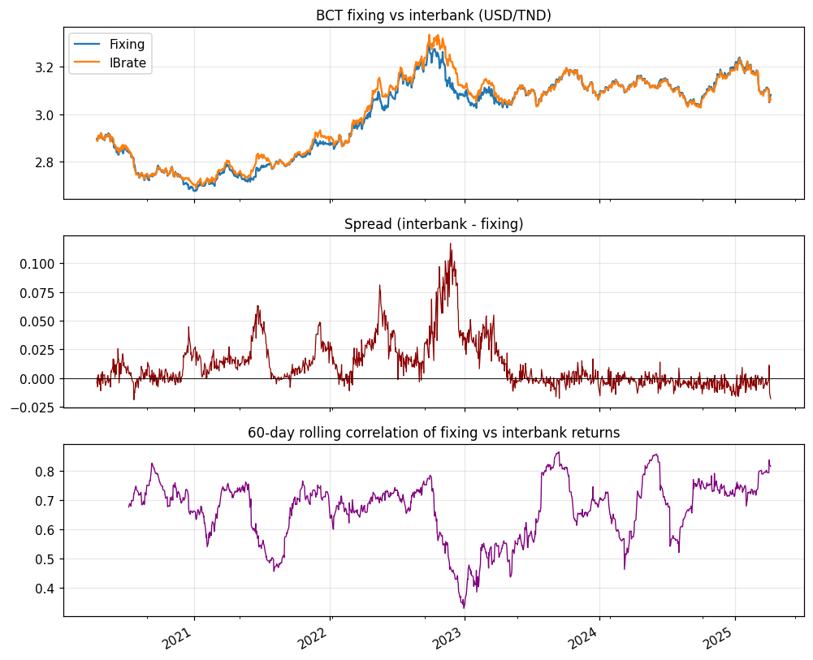

# Nowcasting the Tunisian Dinar — Official Fixing vs Market Rate

A real-time basket and state-space model for the interbank USD/TND rate under Tunisia's managed
float, built around the gap between the central bank's official fixing and the market rate.

## Overview

Tunisia runs a managed float with capital controls. The Central Bank of Tunisia (BCT) publishes an
official USD/TND **fixing** twice a day, while banks settle dollars at an **interbank** rate that is
only reported with a one-day lag. This project answers two questions on daily data from 2020–2025:

1. **Nowcasting** — can today's interbank rate be estimated in real time from same-day moves in the
   global majors (EUR/USD, GBP/USD, USD/JPY), before the interbank print is published?
2. **Divergence** — how, and when, does the administered fixing pull away from the market rate?

The second question is the distinctive one. Most FX modelling deals with free-floating currencies
and a single price; for a managed currency the wedge between the official and market rate is an
observable measure of foreign-exchange stress, and that is where this work focuses.

## Data

| Series | Description | Period |
|---|---|---|
| BCT fixing | Official USD/TND fixing (bid / ask / mid) | 2020–2025, daily |
| Interbank | Market rate banks trade at (USD leg of a ~20-currency panel) | 2020–2025, daily |
| Majors | EUR/USD, GBP/USD, USD/JPY | 2020–2025, daily |

After alignment and cleaning: **1,260 daily observations** (2020-04-13 to 2025-04-07). All return
series are stationary by ADF (p < 0.001). The data is a coursework terminal export; it ends on
2025-04-07 and is kept in `data/raw/` so the pipeline reproduces exactly.

## Methodology

- **Basket model.** The fixing log-return is a weighted sum of the major-pair log-returns,
  `Δlog(Fixing) = wᵀ Δlog(X)`. Weights are estimated by **OLS** (constant) and a **Kalman filter**
  (random-walk weights). Online SGD and a random-forest-on-inverted-targets approach were tried and
  discarded — neither produced informative time variation.
- **Volatility.** **GARCH(1,1)**, selected by AIC/BIC over four specifications.
- **Interbank = fixing + spread.** The interbank rate is nowcast as the fixing nowcast plus a
  separately modelled fixing-to-market spread (AR(1), **ARIMAX(1,0,1)** with FX exogenous terms,
  and random forest). ARIMAX wins — the spread co-moves with global FX, not just its own lag.
- **Residual correction.** A small MLP on the interbank residual, trained on the training span and
  scored strictly out of sample.
- **Evaluation.** Chronological 80/20 split, one-step nowcasts, benchmarked against a random walk.
  Because a managed rate barely moves day to day, level metrics (MAPE, correlation) flatter every
  model, so **directional accuracy is the metric that separates them**.

## Results

Held-out test year (2024-04 to 2025-04, 252 days):

| Target | Model | MAPE (%) | Corr | DirAcc (%) |
|---|---|---|---|---|
| Fixing | OLS (constant weights) | 0.171 | 0.989 | 55.4 |
| Fixing | Kalman (time-varying) | 0.203 | 0.985 | 53.8 |
| Fixing | Random walk | 0.227 | 0.979 | 47.8 |
| Interbank | Basket + ARIMAX spread | 0.172 | 0.988 | **63.3** |
| Interbank | + NN residual correction | 0.172 | 0.988 | 62.2 |
| Interbank | Random walk | 0.205 | 0.983 | 53.4 |

- The basket-plus-spread nowcast beats the random walk on the interbank rate, mostly in
  **directional accuracy (63% vs 53%)**; the level metrics are near random-walk territory for both.
- The **neural-network correction adds nothing out of sample** — once the basket and spread are
  removed, the daily residual is essentially unpredictable. Reported as-is, not tuned away.
- Dynamic (Kalman) weights do not beat constant (OLS) weights; the basket relationship is
  near-constant and leans almost entirely on the **euro** leg.

**The divergence is the headline finding.** The interbank rate sits above the fixing on 62% of
days; the spread blows out to 0.12 dinar during the 2022–2023 FX-liquidity squeeze, and the 60-day
correlation between fixing and interbank returns falls from its usual ~0.7 to 0.33 in that window before
recovering. The official rate decouples from the market exactly when external pressure peaks.



## How to run

```bash
pip install -r requirements.txt
python main.py
```

This rebuilds every figure and metric in the report into `results/`. An optional live leg
(`python main.py --live`) pulls spot majors from Alpha Vantage and needs an API key in the
`ALPHAVANTAGE_KEY` environment variable.

### What `main.py` does

`main.py` is the single entry point that orchestrates the whole pipeline, calling the modules in
`src/` in order and writing every output to `results/`:

1. **Load & build features** (`data_loader`, `preprocessing`) — read the fixing, interbank, and
   majors series, compute log returns, and make a chronological 80/20 train/test split.
2. **Stationarity** — ADF tests on all series (`results/adf.csv`).
3. **Basket weights** (`basket_weights`) — the OLS constant-weight benchmark plus the discarded
   SGD and random-forest weight attempts, kept to show they add no informative time variation.
4. **Kalman fixing nowcast** (`models`) — time-varying basket weights via a Kalman filter, with
   `(q, r)` tuned on a validation slice inside the training span.
5. **GARCH volatility** — GARCH(1,1) selection, and a Kalman variant with GARCH observation noise
   (parameters estimated on train only, `results/garch_selection.csv`).
6. **Spread models** — AR(1), ARIMAX(1,0,1), and random forest for the fixing-to-market spread.
7. **Interbank nowcast** — fixing nowcast + ARIMAX spread, plus a small MLP residual correction
   trained on train and scored strictly out of sample (reported as-is; it adds nothing).
8. **Benchmarks & divergence** — random-walk baselines, the fixing-vs-interbank divergence stats,
   and basket-weight sensitivity (`results/sensitivity.csv`).
9. **Figures & metrics** — all report figures and the headline numbers in `results/metrics.json`,
   with a short summary table printed to the console.

Everything under `results/` is generated by this script; nothing there is edited by hand.

## Repository structure

```
tnd-fx-nowcasting/
├── README.md
├── requirements.txt
├── LICENSE
├── main.py                 # runs the full pipeline
├── data/raw/               # tnd_fx_data.xlsx (fixing, interbank, majors)
├── src/
│   ├── data_loader.py
│   ├── preprocessing.py    # log returns, ADF, bid/ask spread
│   ├── basket_weights.py   # OLS, SGD, RF weight estimators
│   ├── models.py           # Kalman, GARCH, spread models, residual MLP
│   ├── forecasting.py      # evaluation, benchmarks, sensitivity
│   └── visualization.py
├── results/                # figures + metrics.json
└── report/                 # compiled PDF report
```

## Limitations & next steps

A managed rate is close to a random walk at a daily horizon, so the edge is real but modest and
shows up in direction, not level fit. The fixing is an administered rate the BCT can override, the
headline rests on a single test window, and the data ends in April 2025. Natural extensions: a wider
basket from the 20-currency interbank panel (back to 2004), a regime-aware spread model, and the
same fixing-vs-market decomposition on the dinar's euro leg.

## Context

Group project for **FIN 460 — Dynamic Asset Pricing Theory**, Tunis Business School, supervised by
Dr. Eymen Errais and Dr. Bechir Bouzid. Authors: Mustapha Aziz Laroussi, Salma Regaieg, Yassine
Chakroun, Mohamed Mechri.

📄 [Full report](report/report.pdf)

## License & disclaimer

MIT License. Academic exercise — not investment advice.
